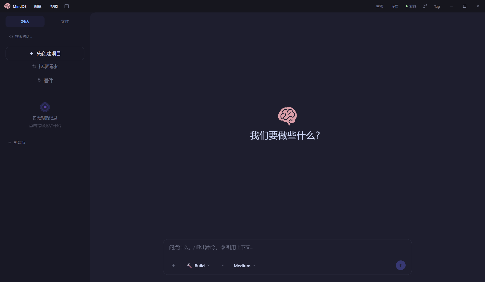
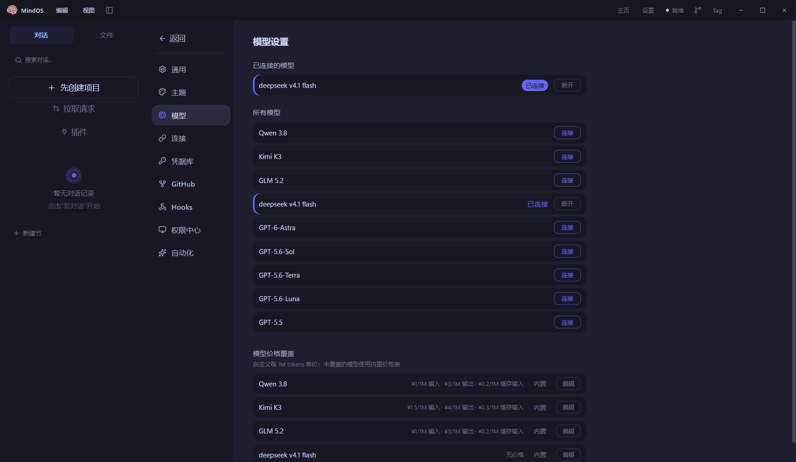

[English](./mindos_desktop.md) | [简体中文](./mindos_desktop.zh-CN.md) · [← Back](../README.zh-CN.md)

# 集成 MindOS Desktop

MindOS Desktop 是一款面向 Windows 的免费、本地优先桌面 AI 编程助手，内置 Codex 引擎。它支持 DeepSeek-V4 系列模型，提供 100 万 token 上下文与 `Medium` / `High` / `Max` 推理强度，并自带审批流与一键 Git/PR 工作流。

- **GitHub：** <https://github.com/xxcr777/deepseek-mindos-desktop>

#### 1. 安装 MindOS Desktop

- 系统要求：Windows 10 / 11（64 位）。
- 从 [GitHub Releases](https://github.com/xxcr777/deepseek-mindos-desktop/releases/latest) 下载最新版本：
  - `MindOS-Setup-<版本>.exe` — 安装版，可自选安装目录；
  - `MindOS-<版本>-win.zip` — 免安装版，解压后双击 `MindOS.exe` 即用。

安装包未做代码签名，首次启动时 Windows SmartScreen 可能提示「已保护你的电脑」—— 点「更多信息 → 仍要运行」即可（仅首次）。

#### 2. 连接 DeepSeek

1. 从 [DeepSeek 开放平台](https://platform.deepseek.com/api_keys) 获取 API Key（`sk-` 开头）。
2. 打开 **设置 → 模型**，找到 **`deepseek v4.1 flash`** 一行，点击 **连接**。

3. 在弹窗中填入 API Key。API 地址为选填项，默认使用 `https://api.deepseek.com/v1`（OpenAI 兼容），除非你使用自定义端点，否则留空即可。
4. 点击 **连接并验证**，然后在对话输入栏中选择该模型。

**说明**

- DeepSeek-V4 支持最高 100 万 token 上下文；MindOS 默认将引擎上下文窗口设为 **100 万（1,000,000）token**。
- 对话输入栏的推理强度选择器提供 `Medium`、`High`、`Max` 三档；`Max` 已完整支持，处理复杂任务时推荐使用。
- 全部本地运行：代码、对话与文件仅发送到你配置的 DeepSeek（或其他）API。

#### 3. 新建项目并开始编码

1. 在首页点击 **新建项目**，选择你的代码文件夹（例如 `D:\my-app`）。
2. 等待标题栏显示 **● 就绪**。
3. 直接描述任务，例如「修复登录按钮的报错」—— MindOS 会修改文件、执行命令，并在对话中以变更卡片展示改动。

#### 审批与 Git 工作流

- **设置 → 权限中心** 可选择由谁批准 AI 的动作：**标准审批**（敏感操作逐一确认）、**AI 代审**（按风险自动评估，信任模式）或 **完全信任**（沙箱内自动执行）。
- AI 默认在 **隔离工作树** 中工作，不弄脏你的主目录。可通过环境信息面板直接在应用内 **提交**、**推送** 与 **创建 PR**。
